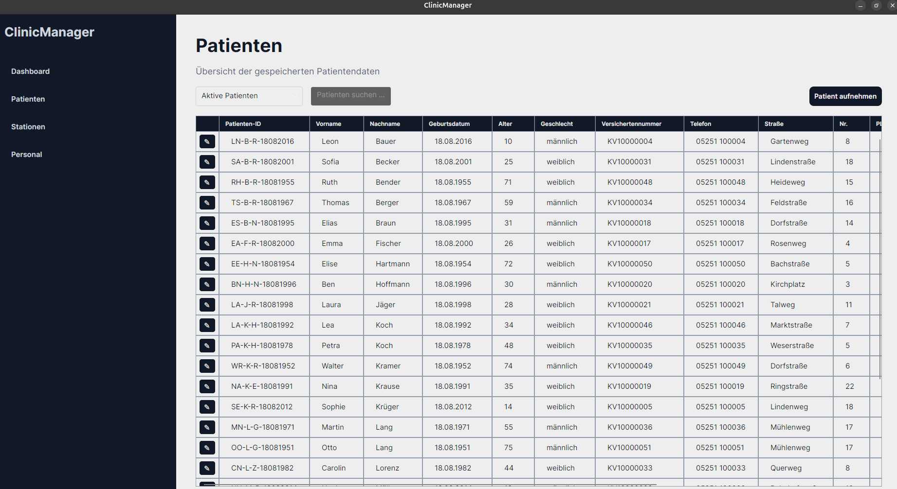

# ClinicManager



ClinicManager is a portfolio-oriented C# desktop application for managing core clinic data in a compact, table-based user interface.

The project demonstrates practical work with **C#**, **.NET 10**, **Avalonia UI**, **MVVM**, **CommunityToolkit.Mvvm**, **Entity Framework Core**, and **SQLite**. It is a learning and portfolio project and is **not intended for real medical use**.

## Current Status — v1.0.0

The first portfolio-ready version focuses on three core areas:

- **Patients**
- **Staff members**
- **Stations**

All three areas use a consistent table-based workflow with search/filtering, create/edit actions, SQLite persistence, and MVVM-based navigation.

The current release builds successfully without compiler warnings, and the current NuGet dependency set reports no known vulnerable packages.

## Implemented Features

### Patient Management

- Table-based patient overview
- Live search
- Filter active, discharged, and all patients
- Create and edit patients
- Store admission/discharge information
- Store station and room references
- Return to the patient table after successful create/edit operations

### Staff Management

- Table-based staff overview
- Live search
- Filter active, former, and all staff members
- Create and edit staff members
- Multiple staff roles
- Optional station and office assignments
- Return to the staff table after successful create/edit operations

### Station Management

- Table-based station overview
- Live search
- Create and edit stations
- Store bed capacity
- Assign one station manager
- Assign one station doctor
- Assign multiple nurses, FSJ staff members, and trainees
- Role-based staff selection
- Resolve stored staff IDs to readable names in the station overview

## Technology Stack

| Area | Technology |
|---|---|
| Programming language | C# |
| Runtime | .NET 10 |
| UI framework | Avalonia UI |
| Architecture | MVVM |
| MVVM toolkit | CommunityToolkit.Mvvm |
| Database | SQLite |
| ORM | Entity Framework Core 10 |
| Data access | Service layer |
| Version control | Git / GitHub |

## Architecture

```text
Models
    Patient, StaffMember, Station, ...

Services
    Database access and CRUD operations

ViewModels
    UI state, commands, filtering, navigation and presentation logic

Views
    Avalonia AXAML user interface

Data
    EF Core DbContext, seeders and JSON demo data
```

The UI is intentionally table-oriented. Main entity views act as central workspaces, and create/edit actions are launched directly from these views instead of using separate menu tiles.

## Demo Data

The repository contains JSON seed files for patients, staff members, and stations so the application can start with a consistent demo dataset.

**All demo data was synthetically generated with ChatGPT for this project.** Names, addresses, phone numbers, insurance numbers, staff assignments, IDs, and other personal-looking information are fictional demo values and do not represent real people or real medical records.

The seed data exists exclusively for development, testing, and demonstration purposes.

## Current Domain Model

```text
Patient
    └── references Station / Room

StaffMember
    └── optional Station assignment

Station
    ├── Station Manager
    ├── Station Doctor
    ├── Nurses
    ├── FSJ Staff
    ├── Trainees
    └── Bed capacity
```

## Planned Development

The following items are planned after v1.0.0 and are not required for the initial portfolio release.

### Domain / Station Details

- Complete the `Bed` model and persistence
- Evaluate a dedicated `Room` model
- Model the relationship `Station -> Room -> Bed -> Patient`
- Add a station detail view with a bed table
- Highlight free beds using the application's success color
- Add patient search inside the station detail view

### Dashboard

- Current date and weekday
- Number of active patients
- Number of active staff members
- Total / occupied / free beds
- Station occupancy overview
- Placeholder cards for upcoming surgeries
- Placeholder cards for upcoming therapies

### UI Polish

- Finalize checkbox styling for station staff selection
- Refine icons and action controls in table views
- Improve spacing and visual consistency in forms
- Add additional screenshots / preview images
- Review responsive behavior for different window sizes

### Later Ideas

- Patient history / patient record
- Surgery appointments
- Therapy appointments
- Medication management
- Anamnesis information
- User/login concept
- Role-based permissions
- Tests and logging

## Getting Started

Requirements:

- .NET 10 SDK
- A desktop environment supported by Avalonia UI

Clone the repository and run:

```bash
dotnet restore
dotnet run
```

The SQLite database and demo data are initialized by the application.

## Portfolio Focus

ClinicManager demonstrates:

- Object-oriented programming with C#
- Desktop UI development with Avalonia
- MVVM architecture
- Data binding and commands
- CRUD workflows
- LINQ
- SQLite persistence
- Entity Framework Core
- Service-oriented data access
- JSON-based demo data seeding
- Domain modeling
- Consistent table-based UX
- Incremental software design and refactoring

## Disclaimer

ClinicManager is a **demo and learning project**.

It is not intended for:

- real patient data
- real employee data
- clinical decision-making
- medical documentation
- production use in a healthcare environment

All included demo data is synthetic and was generated with ChatGPT.

## Author
developed by Deniz Inan
